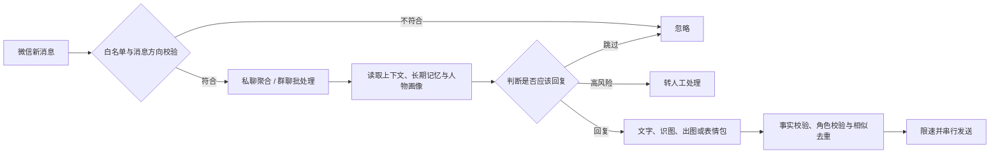

# 微信智能回复 Agent（WeChat Auto-Reply Agent）

一个会**理解上下文、积累长期记忆、识别图片、生成图片，并以不同人物风格自然回复**的本地微信智能助手。

它把 **Ollama 本地大模型** 与 **微信 PC 客户端** 对接，实现「收到消息 → 多轮上下文理解 → 判断是否回复 → 组织表达 → 自动发送」。它不是传统的“关键词触发机器人”，而是一套面向真实聊天场景设计的自动回复系统：先判断**该不该回复**，再结合聊天对象、历史语境、人物画像和当前消息组织表达，尽量减少答非所问、重复回复、角色混淆和过度打扰。

> **免责声明**：本项目涉及微信客户端 Hook 与逆向适配，**仅供学习研究**。使用可能违反腾讯服务条款，存在账号风控风险，请自行评估；**切勿用于骚扰、营销等用途**。建议仅对白名单内自己的测试号开启自动回复。

---

## 功能特性

### 1. 更接近真人的回复逻辑
- **决策层 + 表达层**两阶段处理：先判断 `回复 / 跳过 / 转人工`，再决定具体怎么说。
- 根据消息长度、连续消息数和聊天节奏**动态等待**，避免机械秒回。
- 支持拆分为少量聊天气泡，保留口语感，同时限制刷屏。
- 可配置称呼、语气、句长、表情习惯、口头禅、禁用表达和真实回复示例。
- 对转账、验证码、隐私、承诺、争议等**高风险话题自动谨慎**，必要时转交本人。

### 2. 真正基于历史形成记忆
- **短期原文 + 长期摘要**双层记忆结构：短期保留近期原文（理解代词、追问、当前话题），长期从历史消息中增量提炼关系、偏好、重要事件。
- 只对加入白名单的会话生成/更新记忆。
- 摘要失败不推进进度，下一轮自动补偿，不静默丢原文。
- 提供全量聊天记录人物画像分析工具。

### 3. 一人一套人物风格
- 按会话绑定独立人物画像：双方关系、称呼、语气、句长、表情偏好、口头禅、真实表达样例、禁用措辞与敏感边界。

### 4. 图片理解、图片生成与表情包
- 收到图片可调用多模态模型理解内容，再结合前后文字回复。
- 支持 Gemini 图片生成，带 Cookie 自动同步、续期与失效回退。
- 图片生成采用“结果优先”策略：成功发图配文，失败才输出降级说明。
- 可学习微信收藏的表情包，下载、分类、缓存和语境匹配；带概率、冷却、每日上限和严肃话题保护。

### 5. 面向活跃群聊的多人理解
- 将短时间多条消息**合并理解**，而非逐条抢答。
- 为不同发言人标注身份，降低张冠李戴。
- 支持 @、问句、关键词、图片等多种触发条件；图片可与随后文字自动关联。
- 持久化队列 + 任务过期 + 公平调度；最终发送全局串行化，减少乱序和重复。

### 6. 私聊 / 群聊 / 企业微信联系人统一管理
- 支持普通好友、群聊、企业微信/OpenIM 联系人识别与搜索。
- 网页管理面板可浏览、搜索联系人，设置是否自动回复及绑定风格。
- 非白名单会话默认不自动回复、不建立自动记忆。

### 7. 针对“已读乱回”的多重保护
- 明确区分 `assistant`（自己）与 `user`（对方）的消息方向。
- 回复前检查问题是否真正被理解，过滤凭空虚构情节、不可靠追问。
- 持久化记录近期自动回复，检测相似内容并自动改写。
- 对自身消息回流、重复事件、重启补拉消息去重。

### 8. 稳定运行能力
- `start_all.bat` 一键启动，`stop_all.bat` 统一停止。
- 后台守护 + 异常自动重启、单实例互斥、Hook 熔断保护。
- 会话变更驱动轮询 + 低频兜底检查；重启可补拉消息并校验方向去重。
- 配置支持热更新，常规白名单和策略调整无需重启全部组件。

---

## 工作原理



---

## 环境要求

| 组件 | 说明 |
|------|------|
| Windows 10/11 | 微信 PC 客户端 |
| 微信版本 | 已适配 **4.1.9.52**（其他版本需重新移植偏移） |
| [Ollama](https://ollama.com) | 本地大模型，推荐 `qwen2.5:7b` |
| Python 3.10+ | 核心为标准库 + 少量第三方依赖（见 `requirements.txt`） |
| MSVC | 编译 WeChat-Hook（VS Build Tools） |
| GPU | 可选；1050 Ti 4G 可跑 7b（显存+内存混合，稍慢） |

---

## 快速开始 / 试用方法

### 第 1 步：安装 Ollama 并拉取模型

```powershell
ollama pull qwen2.5:7b
```

### 第 2 步：编译并侧载 Hook

> 本仓库为**便携版发布包**，`WeChat-Hook` 的 C++ 源码在源码仓库另行维护。若你持有 Hook 源码，用 VS 打开 `WeChat-Hook/x64_Version_dll.sln`，`Release x64` 编译，将生成的 `version.dll` 复制到微信安装目录（与 `Weixin.exe` 同级）。

启动微信后，Hook HTTP 服务监听 `http://127.0.0.1:30001`。

### 第 3 步：配置自动回复

```powershell
copy autoreply_config.example.json autoreply_config.json
# 编辑 reply_to 填入要自动回复的 wxid；留空 = dry-run（只打印不发送）
```

### 第 4 步：一键启动（推荐）

双击 **`start_all.bat`**，脚本会自动：
1. 检查 Python / Ollama / WeChat Hook；
2. 若无配置则从 `autoreply_config.example.json` 生成；
3. 后台启动自动回复守护进程；
4. 启动网页管理面板并打开浏览器 `http://127.0.0.1:8848`。

停止全部服务：双击 **`stop_all.bat`**。

### 第 5 步：在网页管理面板配置白名单

```powershell
python wechat_web.py        # 或双击 web_panel.bat
# 浏览器访问 http://127.0.0.1:8848
```

在面板中搜索好友 / 群聊，点击「加入」即可加入自动回复白名单；也可调整模型、轮询间隔、人物风格，并导入本地知识库。

### 第 6 步：手动启动（可选）

```powershell
powershell -ExecutionPolicy Bypass -File .\autoreply_service.ps1 start
python wechat_web.py
```

守护进程单独管理：

```powershell
powershell -ExecutionPolicy Bypass -File .\autoreply_service.ps1 status   # 查看状态
powershell -ExecutionPolicy Bypass -File .\autoreply_service.ps1 log     # 查看日志
```

---

## 配置说明

`autoreply_config.json` 主要字段：

| 字段 | 说明 |
|------|------|
| `reply_to` | 白名单 wxid 列表；空 = dry-run（只打印不发送） |
| `enabled` | 总开关；`false` 时不读消息、不调用模型，支持热加载 |
| `reply_all` | `true` = 回复所有非系统联系人（**危险**） |
| `interval` | 轮询间隔（秒） |
| `model` | Ollama 模型名，如 `qwen2.5:7b` |
| `personas` | 每个会话的自由文本人设 |
| `style_profiles` | 每个会话的关系、称呼、语气、口头禅与真实回复示例 |
| `smart_reply` | 两阶段回复、动态节奏、气泡数量与人工接管设置 |
| `memory` | 短期原文数量、历史读取窗口与长期摘要触发条件 |
| `group_reply` | 活跃群增量队列、触发门槛、合并窗口、冷却和任务过期设置 |
| `knowledge_base` | 本地知识库开关、云模型传输许可和检索片段上限 |

完整字段及注释见 `autoreply_config.example.json`。

### 本地知识库
在网页面板「知识库」区域粘贴文字，或导入 `.txt` / `.md` / `.pdf` / `.docx` 文档（PDF 需 `pypdf`；单文件 ≤5 MB、单份 ≤10 万字）。先为目标会话加入白名单，再为每份文档选择可访问的会话，两项权限同时满足才会检索。默认关闭；使用云模型时默认**不发送**文档片段。

### 记忆机制
每个会话对应 `memory/<md5(wxid)>.db`：长期摘要仅对白名单会话更新；默认 `history_window=120`、`keep_recent=20`、`summary_batch=10`。查看某会话记忆：

```powershell
python wechat_memory.py <wxid>
```

---

## 项目结构

```
├── wechat_autoreply.py       # 自动回复守护进程（收→LLM→发）
├── wechat_recv.py            # 从 message_N.db 读取完整消息原文
├── wechat_memory.py          # 每会话独立长期记忆（摘要）
├── wechat_web.py             # 网页管理面板（白名单 / 设置 / 知识库）
├── wechat_contacts.py        # 命令行查联系人 wxid
├── llm_provider.py           # 多模型接入（Ollama / Gemini 等）
├── reply_intelligence.py     # 两阶段智能回复与事实校验
├── wechat_group_queue.py     # 群聊增量队列与调度
├── wechat_knowledge.py       # 本地知识库检索
├── gemini_web_client.py      # Gemini 生图客户端
├── sig_scan.py               # 偏移特征码移植工具
├── autoreply_config.example.json  # 配置模板（复制为 autoreply_config.json）
├── autoreply_service.ps1     # 守护进程管理（start/stop/status/log）
├── start_all.bat / stop_all.bat  # 一键启动 / 停止
├── README.md
└── STABILITY.md
```

---

## 常用命令

```powershell
# 查联系人 wxid
python wechat_contacts.py -s 张三
python wechat_contacts.py --rooms

# 手动发一条测试消息
Invoke-RestMethod -Uri http://127.0.0.1:30001/SendTextMsg -Method Post `
  -ContentType "application/json; charset=utf-8" `
  -Body '{"wxidorgid":"filehelper","msg":"hello"}'

# 守护进程
.\autoreply_service.ps1 start | stop | status | log
```

---

## 版本适配（其他微信版本）

若微信升级，需重新移植 Hook 偏移：
1. 准备参考版与目标版 `Weixin.dll`；
2. 运行 `sig_scan.py`（发消息偏移）、`sig_scan_db.py`（数据库偏移）；
3. 用 `struct_diff.py` 检查 `TextMessage` 结构体布局；
4. 更新 Hook 的偏移定义并重新编译。

---

## 安全与隐私（务必阅读）

- **仓库建议保持 `Private`**，勿公开 Hook 相关代码。
- 以下文件含个人数据，**切勿提交**（本仓库 `.gitignore` 已默认排除）：
  - `autoreply_config.json`（含个人 wxid）
  - `gemini_cookies.json`（含 Cookie）
  - `autoreply_state.json`、`autoreply.log`
  - `memory/`、`personality_reports/`、`knowledge_base/`、`sticker_cache/`、`WeChat/`、`runtime/`
- 频繁自动回复可能触发微信风控，注意频率与内容。
- 涉及审批、保密、合同、合规等结论，务必人工核实后再发送。

---

## License

本项目**仅供学习研究**。WeChat-Hook 部分遵循其原项目许可；Python 脚本与适配工具仅供学习研究使用。使用本项目产生的风险与责任由使用者自行承担。
